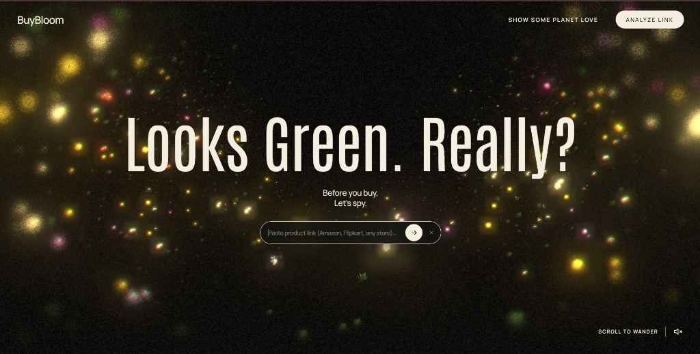
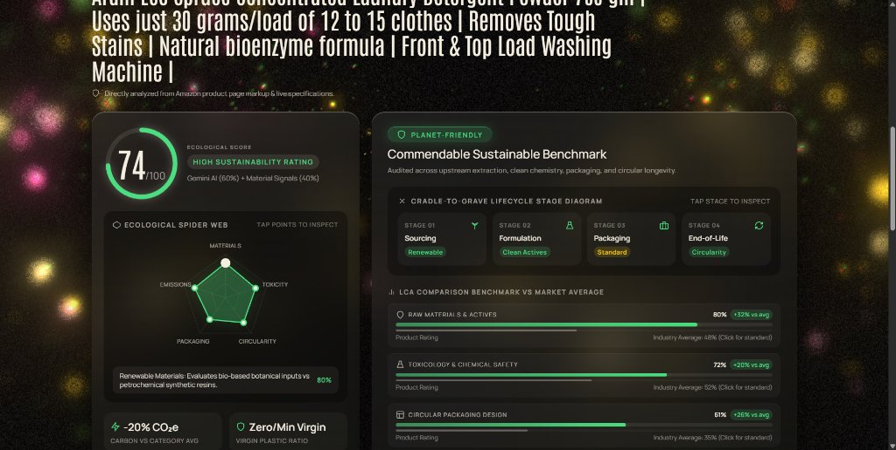

# 🌸 BuyBloom — 3D Bioluminescent Product Eco-Analyzer

> **"Looks Green. Really? Before you buy, Let's spy."**  
> An immersive, 3D WebGL bioluminescent valley application that audits consumer products for authentic sustainability, life-cycle carbon debt, and deceptive greenwashing claims in real-time using Google Gemini AI.

---

## 📸 Visual Walkthrough

### 1. Landing Experience — 3D Night Garden
Users arrive at an atmospheric, bioluminescent valley of night flowers with interactive depth-scrolling and procedural particle fields.


### 2. 3D Procedural Floral Valley Engine
Built with Three.js/WebGL shaders, featuring dynamic lighting, acoustic soundscapes, and procedural terrain growth.


### 3. Real-Time Ecological Audit Dashboard
Upon pasting any e-commerce product link (Amazon, Flipkart, etc.), BuyBloom parses the product specifications and renders an instant Life Cycle Assessment (LCA), including an **Ecological Spider Web Radar Chart** and **Cradle-to-Grave Stage Diagram**.


### 4. Comparison Tree Timeline & Greener Guidance
Scroll through the **interactive comparison timeline**: an active directional arrow tracks your scroll position along the central bus line as **Ecological Strengths** and **Environmental Concerns** branch out node-by-node. Below, 4 synchronized pillar drawers and a strategic pre-purchase checklist guide conscious purchasing decisions.


---

## 🧠 Artificial Intelligence (AI) Architecture: Where, When & How

BuyBloom integrates multiple AI and Machine Learning paradigms to convert messy e-commerce listings into rigorous sustainability intelligence:

```
[ User Pastes E-Commerce Link ]
               │
               ▼
   [ Multi-Tier Web Scraper ]
    (Mobile Headers, JSON-LD, Slug Fallback)
               │
               ▼
┌─────────────────────────────────────────────────────────────┐
│                   AI ANALYSIS PIPELINE                      │
├─────────────────────────────────────────────────────────────┤
│ 1. LLM Contextual Reasoning (Google Gemini 3.8 Flash)        │
│    • Ingests raw ingredients, materials & claims            │
│    • Cross-references FTC Green Guides & EU Directives      │
│                                                             │
│ 2. Schema-Enforced JSON Output Generation                    │
│    • Deterministic metrics: eco_score, lifecycle breakdown  │
│    • Ingredient-attributed cause & effect mechanisms        │
│                                                             │
│ 3. Automated Heuristic Fallback Engine                      │
│    • Gracefully catches 503/rate limits with local NLP rules│
└─────────────────────────────────────────────────────────────┘
               │
               ▼
[ Interactive 3D Frontend: Spider Radar, Comparison Tree, 4 Pillars ]
```

### 1. Generative LLM Reasoning (Google Gemini API)
- **Where it is used:** In the backend analysis module (`eco_analyzer.py` $\rightarrow$ `analyze_product()`).
- **When it runs:** Immediately after the server extracts the raw product text, bullet points, and ingredient lists from an e-commerce page.
- **Why & How:** Traditional keyword searches fail because marketing text is intentionally misleading. A brand might say *"100% natural herbal extracts"* while omitting that the base contains petroleum-derived microplastics. Gemini reads the entire product profile holistically, detecting subtle chemical tradeoffs, synthetic binders, and misleading claims.

### 2. Schema-Enforced Structured Output Generation
- **Where it is used:** In the Gemini API configuration (`generationConfig: {"responseMimeType": "application/json"}`).
- **When it runs:** During the LLM inference step.
- **Why & How:** Large language models typically output unstructured conversational text. To drive the 3D animated dials, spider radar charts, and comparison nodes, BuyBloom constrains Gemini to return an exact, typed JSON schema:
  - `eco_score` (Integer 0–100)
  - `positive_factors` (`[{headline, ingredient, cause_and_effect, lca_stage, eco_impact}]`)
  - `negative_factors` (`[{headline, ingredient, cause_and_effect, lca_stage, eco_impact}]`)
  - `greenwash_warning` (Specific misleading claims identified)
  - `greener_tip` (Actionable cleaner alternatives)

### 3. AI-Driven Life Cycle Assessment (LCA)
- **Where it is used:** Across the Cradle-to-Grave Stage Diagram and Comparison Benchmarks.
- **When it runs:** When evaluating raw ingredient inputs and manufacturing paths.
- **Why & How:** Industrial Life Cycle Assessment (LCA) software (like GaBi or SimaPro) costs thousands of dollars and requires complex supply-chain disclosures. BuyBloom's AI approximates ISO 14040/14044 principles across 4 core phases:
  1. **Raw Material Extraction:** Renewable agro-waste vs. virgin petrochemical polymers.
  2. **Formulation & Chemistry:** Aquatic ecotoxicity, toxic binders, or harsh surfactants.
  3. **Packaging & Transit:** Curbside recyclable cardboard vs. single-use LDPE shrink-wrap.
  4. **End-of-Life:** Real home compostability vs. municipal landfill anaerobic methane generation.

### 4. Semantic Greenwashing Detection
- **Where it is used:** In the **Greenwashing Alert** banner (`#gwCard`).
- **When it runs:** When analyzing brand marketing buzzwords.
- **Why & How:** The AI cross-references product claims against regulatory advertising standards (**US FTC Green Guides** & **EU Green Claims Directive**). Unregulated buzzwords like *"Chemical-Free"* (scientifically impossible) or *"Organic"* without accredited certification numbers (USDA Organic, ECOCERT, COSMOS) are flagged as misleading to consumers.

### 5. Explainable AI (XAI) & Attribution
- **Where it is used:** In the interactive **Comparison Tree**.
- **When it runs:** When rendering the positive strengths and negative concerns.
- **Why & How:** Black-box numbers like "74/100" do not build user trust. Every point in the comparison tree is explicitly attributed to a specific ingredient, explaining the precise chemical mechanism and lifecycle stage (e.g. *"Protease and lipase enzymes hydrolyze stains at low temperatures, saving electrical heating energy"*).

### 6. Fault-Tolerant Heuristic Fallback
- **Where it is used:** In `eco_analyzer.py` $\rightarrow$ `rule_based_audit()`.
- **When it runs:** If the external LLM API encounters rate limits, timeouts, or HTTP 503 high-demand errors.
- **Why & How:** A local expert rule engine with pre-compiled ecological signal dictionaries (apiculture, stationery, personal care, textiles) takes over instantly so the user experience never fails or stalls.

---

## 🕷️ How Web Scraping is Engineered

E-commerce sites employ aggressive anti-bot protections, Cloudflare challenges, and CAPTCHAs. BuyBloom uses a specialized, multi-tier Python scraping pipeline in `eco_analyzer.py`:

```
               [ Input E-Commerce URL ]
                          │
                          ▼
             [ HTTP Redirect Resolution ]
            (Unfurls amzn.in/d/... short links)
                          │
                          ▼
            [ Mobile Safari Header Spoofing ]
       (Bypasses desktop bot shields via iOS headers)
                          │
         ┌────────────────┴────────────────┐
         ▼                                 ▼
   [ 200 OK Response ]              [ CAPTCHA / Blocked ]
         │                                 │
         ├─► 1. JSON-LD Microdata          └─► 4. URL Slug Extraction
         ├─► 2. OpenGraph Meta Tags              (Zero-failure fallback)
         └─► 3. DOM CSS Selectors
```

### 1. Mobile Safari Header Masquerading
- Traditional desktop scrapers get blocked immediately. BuyBloom uses `requests.Session` with an **Apple iOS Safari** user-agent string:
  ```python
  headers = {
      'User-Agent': 'Mozilla/5.0 (iPhone; CPU iPhone OS 17_5_1 like Mac OS X) AppleWebKit/605.1.15 (KHTML, like Gecko) Version/17.5 Mobile/15E148 Safari/604.1',
      'Accept': 'text/html,application/xhtml+xml,application/xml;q=0.9,*/*;q=0.8',
      'Accept-Language': 'en-US,en;q=0.9',
      'Sec-Fetch-Dest': 'document',
      'Sec-Fetch-Mode': 'navigate',
      'Sec-Fetch-Site': 'none'
  }
  ```
- Major retailers serve simpler, server-rendered HTML with lighter bot restrictions to mobile browsers. If the mobile request fails, the engine retries with a modern Chrome desktop header fingerprint.

### 2. Multi-Tier HTML Parsing with BeautifulSoup4
When the HTML arrives, data extraction executes in strict priority order:
1. **Schema.org JSON-LD Microdata**:
   Scrapes `<script type="application/ld+json">` for Google-standard `Product` schema to extract the official title, brand, and manufacturer descriptions without breaking when retailers change their CSS classes.
2. **OpenGraph & Twitter Cards**:
   Inspects `og:title`, `og:description`, and `meta[name="description"]` for clean product summaries.
3. **Store-Specific DOM Selectors**:
   Targets Amazon-specific elements (`#productTitle`, `#feature-bullets`, `#productDescription`, technical specification tables).

### 3. URL Slug Fallback (Zero-Failure Safety Net)
- If an IP address is hard-challenged by a retailer's anti-bot system, the scraper extracts semantic keywords directly from the URL path:
  $$\text{amazon.in/Bonkaso-Bagasse-Disposable-Compartment-Plate/dp/B0...} \longrightarrow \textbf{"Bonkaso Bagasse Disposable Compartment Plate"}$$
- The extracted keywords feed directly into the AI analyzer, ensuring the user **never** sees an error screen.

---

## 🛠️ Tech Stack

| Layer | Technologies |
|---|---|
| **3D & Graphics** | Three.js, WebGL GLSL Shaders, Procedural Particles, CSS 3D Transforms |
| **Frontend & UI** | Single-file architecture, Vanilla JavaScript (ES6+), Cormorant Garant & Antonio typography |
| **Backend** | Python 3, Flask, Flask-CORS |
| **Scraping & Ingestion** | Requests, BeautifulSoup4 (`html.parser`), JSON-LD |
| **AI & NLP** | Google Gemini API (`gemini-3.8-flash` / `gemini-3.5-flash`), Custom Heuristic Rule Engine |

---

## 🚀 Quick Start

### 1. Clone the repository
```bash
git clone https://github.com/sujanshetty707/Fernhollow.git
cd Fernhollow
```

### 2. Install dependencies
```bash
pip install -r requirements.txt
```

### 3. Set up environment variables
Create a `.env` file in the root directory:
```env
GEMINI_API_KEY=your_google_gemini_api_key_here
PORT=3000
```

### 4. Run the server
```bash
python server.py
```
Open **`http://localhost:3000`** in your browser.

---

## 📄 Documentation

- [explainable.md](explainable.md) — Comprehensive deep dive into the AI models, algorithms, and sustainability scoring criteria.

---

## 📜 License

MIT License — free for educational and personal use.
