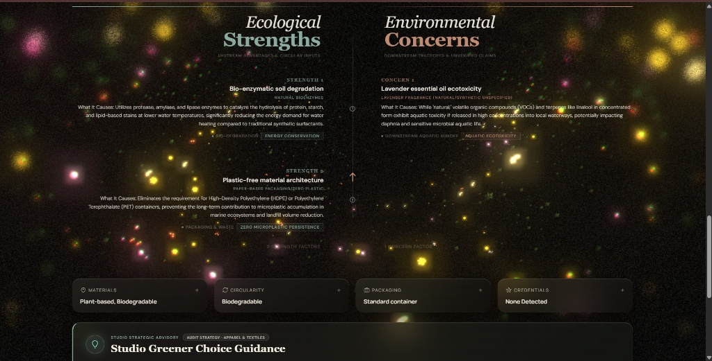

# 🌸 BuyBloom — The AI Greenwashing Detective 🕵️‍♂️🌿
### *Because slapping a green leaf emoji on plastic packaging doesn't make it biodegradable.*

> **"Looks Green. Really? Before you buy, Let's spy."**  
> **BuyBloom** is an autonomous, utility-driven AI agent wrapped in an interactive 3D WebGL bioluminescent valley. It ruthlessly dissects e-commerce marketing fluff, performs automated Cradle-to-Grave Life Cycle Assessments (LCA), and exposes deceptive greenwashing in 3 seconds flat using Google Gemini AI.

---

## 🎓 The AI Foundations Behind BuyBloom *(Based on Essentials of AI)*

BuyBloom isn't just a pretty 3D valley; it is engineered directly on classic and modern **Artificial Intelligence principles**:

### 1. The PEAS Agent Framework
Before writing a single line of code, BuyBloom was formulated as a formal rational agent:
| Element | Description in BuyBloom |
|---|---|
| **Performance Measure (P)** | Greenwashing detection precision, LCA breakdown accuracy, calculation latency (<3 seconds), and user-trust calibration. |
| **Environment (E)** | Partially observable (merchants hide toxic ingredients), stochastic (noisy marketing jargon, dynamic inventory, bot shields), sequential, and discrete-continuous hybrid. |
| **Actuators (A)** | 3D WebGL valley renderer, SVG Spider Web radar chart, Comparison Tree timeline, and structured JSON audit payloads. |
| **Sensors (S)** | Multi-tier web scraper (DOM parser, JSON-LD microdata extractor, URL slug tokenizer). |

### 2. Rational Agent Classification: *Utility-Based & Model-Based*
- **Acting Rationally ("Do the Best Thing")**: Rather than mimicking human shopping biases, BuyBloom evaluates products purely against empirical environmental outcomes.
- **Utility-Based Agent**: Real sustainability is never black-and-white. BuyBloom uses a **multi-attribute utility function** to evaluate complex trade-offs: *Does a biodegradable bagasse plate offset the carbon cost of shipping it across the globe in plastic shrink-wrap?*
- **Model-Based Reflex Agent (Heuristic Fallback)**: Maintains an internal model of the world (database of botanical feedstocks, polymers, and REACH/FTC standards) so it can act even when internet access or LLM APIs encounter outages.

### 3. Neuro-Symbolic Hybrid AI
BuyBloom unites the two great tribes of artificial intelligence:
1. **Connectionist / Generative AI (Google Gemini 3.8 Flash)**: Reads messy, unstructured human marketing text, understands context, and deduces hidden chemical tradeoffs.
2. **Symbolic / Rule-Based Expert System (Forward-Chaining Logic)**: Uses deterministic IF-THEN rules and legal compliance matrices (FTC Green Guides & EU Directives) to enforce zero-hallucination ground truth.

### 4. Taxonomy of Data & The ETL Pre-processing Pipeline
- **Unstructured Data $\rightarrow$ Structured Intelligence**:
  - *Unstructured Data*: Marketing fluff, Amazon bullet points, customer reviews.
  - *Semi-Structured Data*: Schema.org `application/ld+json` product microdata.
  - *Structured Data*: Normalized $[0, 100]$ LCA vectors and spider-radar coordinates.
- **Data Cleaning & Noise Reduction**: Automated removal of HTML tags, duplicate promotional claims, whitespace noise, and regex extraction of ASIN identifiers.
- **Feature Scaling**: Min-Max normalization to standard $[0, 100]$ sustainability indices without letting extreme outliers distort ratings.

---

## 📸 Visual Walkthrough

### 1. 3D Procedural Floral Valley Engine
Built with Three.js and WebGL GLSL shaders, featuring dynamic atmospheric bloom, acoustic night-garden soundscapes, and procedural terrain growth.


### 2. Landing Experience — *"Looks Green. Really?"*
Users arrive at an atmospheric, bioluminescent valley of night flowers with interactive depth-scrolling and real-time link ingestion.


### 3. Real-Time Ecological Audit Dashboard
Upon pasting any e-commerce link (Amazon, Flipkart, etc.), BuyBloom parses product specifications into a **Composite Eco Score**, **Ecological Spider Web Radar Chart**, and a **Cradle-to-Grave Stage Diagram**.


### 4. Comparison Tree Timeline & Greener Choice Guidance
An active directional arrow tracks your scroll position along the central bus line as **Ecological Strengths** and **Environmental Concerns** branch out node-by-node. Below, 4 synchronized pillar drawers and a pre-purchase checklist guide conscious purchasing.


---

## 🧠 AI Architecture: Where, When & How

```
[ User Pastes E-Commerce Link ]
               │
               ▼
   [ Multi-Tier Web Scraper ]
    (Mobile Headers, JSON-LD, Slug Fallback)
               │
               ▼
┌─────────────────────────────────────────────────────────────┐
│                   AI ANALYSIS PIPELINE                      │
├─────────────────────────────────────────────────────────────┤
│ 1. LLM Contextual Reasoning (Google Gemini 3.8 Flash)        │
│    • Ingests raw ingredients, materials & claims            │
│    • Cross-references FTC Green Guides & EU Directives      │
│                                                             │
│ 2. Schema-Enforced JSON Output Generation                    │
│    • Deterministic metrics: eco_score, lifecycle breakdown  │
│    • Ingredient-attributed cause & effect mechanisms        │
│                                                             │
│ 3. Automated Heuristic Fallback Engine                      │
│    • Gracefully catches 503/rate limits with local NLP rules│
└─────────────────────────────────────────────────────────────┘
               │
               ▼
[ Interactive 3D Frontend: Spider Radar, Comparison Tree, 4 Pillars ]
```

### 1. Generative LLM Reasoning (Google Gemini API)
- **Where it is used:** Backend analysis engine (`eco_analyzer.py` $\rightarrow$ `analyze_product()`).
- **When it runs:** Immediately after the server extracts the raw product text and ingredient lists.
- **Why & How:** Traditional software searches for keywords like "bamboo" and blindly marks it green. Gemini understands context: *Is that bamboo bonded with toxic melamine plastic resin?* Gemini reads the entire product profile holistically, detecting chemical compromises and hidden synthetics.

### 2. Schema-Enforced Structured Output Generation
- **Where it is used:** Gemini API configuration (`generationConfig: {"responseMimeType": "application/json"}`).
- **When it runs:** During the LLM inference step.
- **Why & How:** LLMs love writing long essays. Frontends hate essays; they need numbers to draw charts. BuyBloom constrains Gemini to return an exact, typed JSON schema:
  - `eco_score` (Integer 0–100)
  - `positive_factors` (`[{headline, ingredient, cause_and_effect, lca_stage, eco_impact}]`)
  - `negative_factors` (`[{headline, ingredient, cause_and_effect, lca_stage, eco_impact}]`)
  - `greenwash_warning` (Deceptive claims detected)
  - `greener_tip` (Actionable cleaner alternatives)

### 3. AI-Driven Life Cycle Assessment (LCA)
- **Where it is used:** Across the Cradle-to-Grave Stage Diagram and Comparison Benchmarks.
- **When it runs:** When evaluating raw ingredient inputs and manufacturing paths.
- **Why & How:** Real industrial LCA audits cost thousands of dollars. BuyBloom's AI approximates ISO 14040/14044 principles across 4 core phases:
  1. **Raw Material Extraction:** Renewable agro-waste vs. virgin petrochemical polymers.
  2. **Formulation & Chemistry:** Aquatic ecotoxicity, toxic binders, or harsh surfactants.
  3. **Packaging & Transit:** Curbside recyclable cardboard vs. single-use LDPE shrink-wrap.
  4. **End-of-Life:** Real home compostability vs. municipal landfill anaerobic methane generation.

### 4. Semantic Greenwashing Detection
- **Where it is used:** In the **Greenwashing Alert** banner (`#gwCard`).
- **When it runs:** When analyzing brand marketing buzzwords.
- **Why & How:** The AI matches claims against regulatory advertising standards (**US FTC Green Guides** & **EU Green Claims Directive**). Unregulated buzzwords like *"Chemical-Free"* (scientifically impossible—even water is a chemical) or *"100% Eco-Pure"* without accredited certifications (USDA Organic, ECOCERT, COSMOS) are immediately flagged.

### 5. Explainable AI (XAI) & Attribution
- **Where it is used:** In the interactive **Comparison Tree**.
- **When it runs:** When rendering strengths and concerns.
- **Why & How:** Users distrust unexplained black-box scores like "74/100". Every point in the comparison tree is explicitly attributed to a specific ingredient, explaining the precise chemical mechanism and lifecycle stage (e.g. *"Protease and lipase enzymes hydrolyze stains at low temperatures, saving electrical heating energy"*).

### 6. Fault-Tolerant Heuristic Fallback
- **Where it is used:** In `eco_analyzer.py` $\rightarrow$ `rule_based_audit()`.
- **When it runs:** If the external LLM API encounters rate limits, timeouts, or HTTP 503 high-demand errors.
- **Why & How:** A local expert rule engine with pre-compiled ecological signal dictionaries takes over instantly so the user experience never fails.

---

## 🕷️ How Web Scraping is Engineered

E-commerce sites deploy aggressive anti-bot shields and Cloudflare walls. BuyBloom uses a multi-tier Python scraping pipeline:

```
               [ Input E-Commerce URL ]
                          │
                          ▼
             [ HTTP Redirect Resolution ]
            (Unfurls amzn.in/d/... short links)
                          │
                          ▼
            [ Mobile Safari Header Spoofing ]
       (Bypasses desktop bot shields via iOS headers)
                          │
         ┌────────────────┴────────────────┐
         ▼                                 ▼
   [ 200 OK Response ]              [ CAPTCHA / Blocked ]
         │                                 │
         ├─► 1. JSON-LD Microdata          └─► 4. URL Slug Extraction
         ├─► 2. OpenGraph Meta Tags              (Zero-failure fallback)
         └─► 3. DOM CSS Selectors
```

### 1. Mobile Safari Header Masquerading
- Traditional desktop scrapers get blocked instantly. BuyBloom uses `requests.Session` with an **Apple iOS Safari** user-agent:
  ```python
  headers = {
      'User-Agent': 'Mozilla/5.0 (iPhone; CPU iPhone OS 17_5_1 like Mac OS X) AppleWebKit/605.1.15 (KHTML, like Gecko) Version/17.5 Mobile/15E148 Safari/604.1',
      'Accept': 'text/html,application/xhtml+xml,application/xml;q=0.9,*/*;q=0.8',
      'Accept-Language': 'en-US,en;q=0.9',
      'Sec-Fetch-Dest': 'document',
      'Sec-Fetch-Mode': 'navigate',
      'Sec-Fetch-Site': 'none'
  }
  ```
- E-commerce platforms serve lighter, server-rendered HTML with lower bot restrictions to mobile browsers. If the mobile request fails, it automatically retries with a modern Chrome desktop fingerprint.

### 2. Multi-Tier HTML Parsing with BeautifulSoup4
1. **Schema.org JSON-LD Microdata**: Scrapes `<script type="application/ld+json">` for Google-standard `Product` schema to extract the official title, brand, and manufacturer descriptions without breaking when retailers change their CSS classes.
2. **OpenGraph & Twitter Cards**: Inspects `og:title`, `og:description`, and `meta[name="description"]` for clean product summaries.
3. **Store-Specific DOM Selectors**: Targets Amazon-specific elements (`#productTitle`, `#feature-bullets`, `#productDescription`, technical specification tables).

### 3. URL Slug Fallback (Zero-Failure Safety Net)
- If an IP address is hard-challenged by a retailer's anti-bot system, the scraper extracts semantic keywords directly from the URL path:
  $$\text{amazon.in/Bonkaso-Bagasse-Disposable-Compartment-Plate/dp/B0...} \longrightarrow \textbf{"Bonkaso Bagasse Disposable Compartment Plate"}$$
- The extracted keywords feed directly into the AI analyzer, ensuring the user **never** sees an error screen.

---

## 🛠️ Tech Stack

| Layer | Technologies |
|---|---|
| **3D & Graphics** | Three.js, WebGL GLSL Shaders, Procedural Particles, CSS 3D Transforms |
| **Frontend & UI** | Single-file architecture, Vanilla JavaScript (ES6+), Cormorant Garant & Antonio typography |
| **Backend** | Python 3, Flask, Flask-CORS |
| **Scraping & Ingestion** | Requests, BeautifulSoup4 (`html.parser`), JSON-LD |
| **AI & NLP** | Google Gemini API (`gemini-3.8-flash` / `gemini-3.5-flash`), Custom Heuristic Rule Engine |

---

## 🚀 Quick Start

### 1. Clone the repository
```bash
git clone https://github.com/sujanshetty707/Fernhollow.git
cd Fernhollow
```

### 2. Install dependencies
```bash
pip install -r requirements.txt
```

### 3. Set up environment variables
Create a `.env` file in the root directory:
```env
GEMINI_API_KEY=your_google_gemini_api_key_here
PORT=3000
```

### 4. Run the server
```bash
python server.py
```
Open **`http://localhost:3000`** in your browser.

---

## 📄 Documentation

- [explainable.md](explainable.md) — Comprehensive deep dive into the AI models, algorithms, and sustainability scoring criteria.

---

## 📜 License

MIT License — free for educational and personal use.
